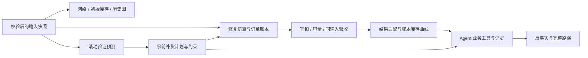

# 旧版接入合同（历史草案，非当前实现说明）

> 此文档写于预测、仿真和 Agent 尚未接入时。现已由 `README.md`、`demo/engine.py` 和 `demo/agent_service.py` 的固定引擎集成方案取代。下面的 API 字段是当时的设计建议，不代表当前 Streamlit 工作台已提供相应 HTTP API；请勿据此判断当前功能状态。

本文件延续原前端规划。当前项目只启用经过输入校验的静态网络、初始库存和历史需求。`demo/provider.py` 是统一数据边界：当前 load_bundle 返回静态 Bundle；后续新增独立 ResultProvider，不往 Bundle 塞未来真值或无来源数字。

最小 HTTP 请求/响应、字段单位及前端启用检查见 [仿真结果接口_最小对接规格.md](仿真结果接口_最小对接规格.md)。该文档是待实现合同，不表示队友当前 `/experiment` 已可用于正式结果展示。

## 1. 依赖顺序

## 2. 统一服务方法

直接 Python 服务优先；后续 FastAPI 可以包装相同函数。前端只做取数与展示，不再实现一套补货或成本算法。

| 服务 | 输入 | 输出 | 启用门槛 |
|---|---|---|---|
| read_network | snapshot_id | nodes、edges、初始状态 | 当前已实现 |
| read_history | snapshot_id、node_id、start、end、authorization | 终端历史或授权汇总 | 当前只读展示已实现；权限视图后置 |
| create_forecast | snapshot_id、cutoff、节点范围、模型配置、已知日历 | ForecastRecord + rolling_evaluation | 不读未来真值，基线和滚动评估通过 |
| create_plan | state_id、forecast_id、截止时间、策略、约束 | PlanLine[] + constraint_checks | 事前可执行计划，不伪称事后订单日志为计划 |
| run_paired | snapshot_id、scenario_id、horizon、共同初态、策略配置 | RunManifest + Metrics[] + 日明细 | 共同输入、初态、成本、事件；模拟器关键检查通过 |
| read_state | run_id、policy_id、date、phase | NodeState[]、Shipment[] | 账本一致，明确决策前/收盘 |
| ask_agent | run_id、as_of、授权范围、问题 | answer、tool_trace、evidence_refs、mode | 工具调用真实、数值引用一致、超时及离线回退 |
| counterfactual | source_run_id、显式变更假设 | 新 run_id 与配置差异、实际重算结果 | 保持其他外生输入与初态一致 |

## 3. JSON 字段合同

以下为计划字段，不表示当前已经产出对应结果。数组对象替代 tuple 字典键。

**RunManifest**：`run_id, snapshot_id, code_version, scenario_id, horizon_days, measurement_start, measurement_end, warmup_rule, initial_state_hash, exogenous_input_hash, cost_config_hash, policy_configs, validation_status, validation_checks, mode`。只有 `validation_status=passed` 才用于正式效果展示。

**NodeState**：`run_id, policy_id, node_id, date, phase, on_hand_units, open_purchase_order_units, in_transit_units, backorders_owed_units, reserved_units, storage_capacity_units`。`phase` 取 `before_action` 或 `closing`。库存位置不能遗漏“已下单未发货”，也不能把同一数量计入两个入站状态。

**ForecastRecord**：`forecast_id, node_id, issue_date, cutoff, target_date, demand_type, mean_units, lower_units, upper_units, model_id`。区间未校准时 lower/upper 为 null；需求类型区分 `terminal_consumption_aggregate` 与 `downstream_orders`。评估至少给出基线、滚动验证区间、MAE/WAPE；分母为零的 WAPE 标记不可用。

**PlanLine**：`plan_id, forecast_id, state_id, buyer, seller, request_units, allocated_units, planned_dispatch_date, expected_arrival_date, target_inventory_units, inventory_position_units, safety_stock_units, constraint_reasons`。计划与执行发货量不同；详情必须说明计算和限制。

**Shipment**：`shipment_id, order_id, seller, buyer, units, dispatch_date, arrival_date, status`。状态区分等待发货和已在途；不得用合计在途代替到货批次。

**Metrics**：`run_id, policy_id, total_cost, cost_breakdown, terminal_demand_units, terminal_sales_units, lost_sales_units, stockout_rate, average_system_inventory_units, turnover_window, inventory_scope, bullwhip_by_tier`。成本分项可复算，周转分子为实际销量；库存范围和测量窗口必须披露。

**AgentResult**：`run_id, as_of, answer, actions, tool_trace, evidence_refs, mode, error`。trace 包含实际工具名、参数、返回摘要、耗时及成功/失败；禁止前端播放虚构调用。密钥通过环境变量保留在服务端，不进入前端、导出或代码库。

## 4. 后端需要先通过的检查

1. 旧欠单不重复累加；**发货为 0 时新订单也必须进入欠单**，部分履约后账本守恒；未发采购订单计入库存位置一次。
2. S1 历史订单序列包含零订单日；预热与测量时钟一致，预热不得反复标为实验第 1 天；运输扰动按实际发运日应用。
3. 到货、处理、生产和库存遵守实际容量；溢出要有明确物理状态与成本，不靠截断库存消失。
4. S1/S2 同输入比较。独立预热只能用于明确披露的稳态比较，不作为同初态干预结论。
5. 分配逻辑与文档一致；规则法可诚实使用，不把共享预测规则称为已实现的全局成本最优。
6. 指标从日志复算。缺货率与实际满足率互补，采购仅在外部进入系统时计费，内部转移不重复采购。
7. 预测/Agent 只能访问决策截止日前信息；场景设计预览不得成为未来决策输入。

## 5. 前端启用检查

- 相同 run_id、policy_id、date 和 phase 的图表、表格、解释互相一致。
- 切换节点/标签不重新运行实验；改配置后旧结果标明原参数，新运行失败不覆盖旧的成功结果。
- 显示实际改善或变差，零分母使用 N/A。缺货率差异使用百分点。
- 历史 7 日移动均值保持“历史统计”标签，不改成“AI 预测”。
- 计划未完成、仿真未通过或 Agent 无有效工具结果时保留禁用状态。
- 先接一个真实正常场景和一个压力场景，再扩展多 seed 页面、动画和公开部署。

交接当前前端：发送源码、data、vendor、reports、README 和本文件。通常排除 `.runtime`、`.venv`、缓存与日志；队友自己安装 requirements。
